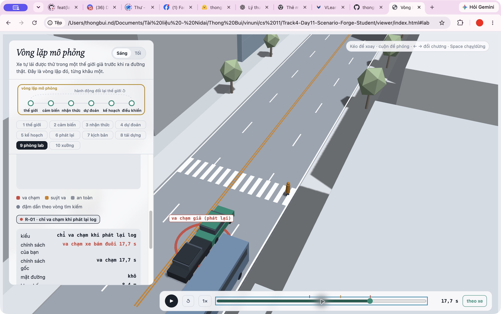
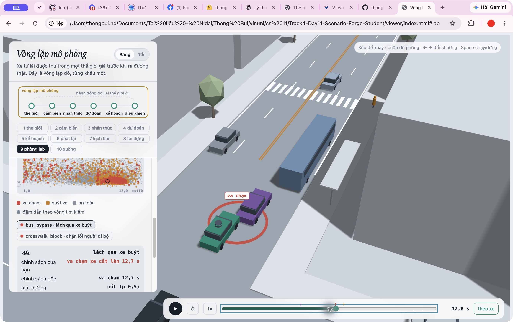
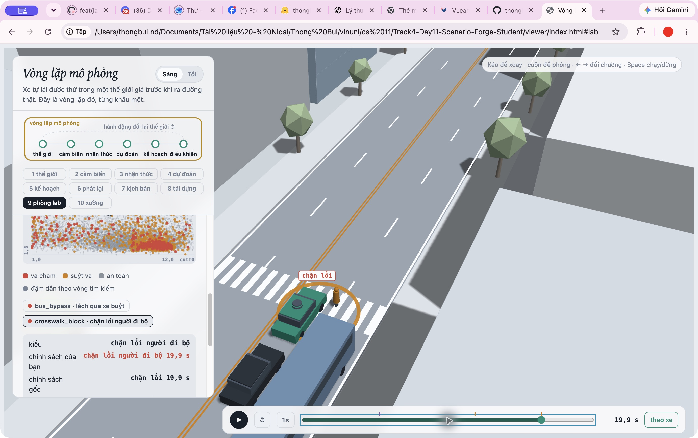
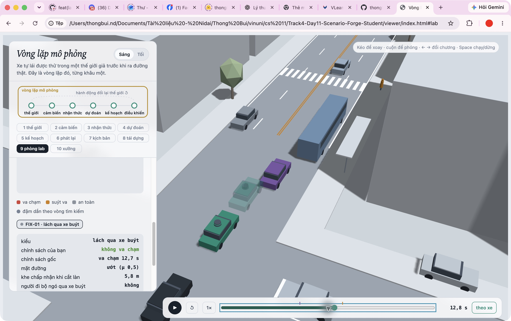
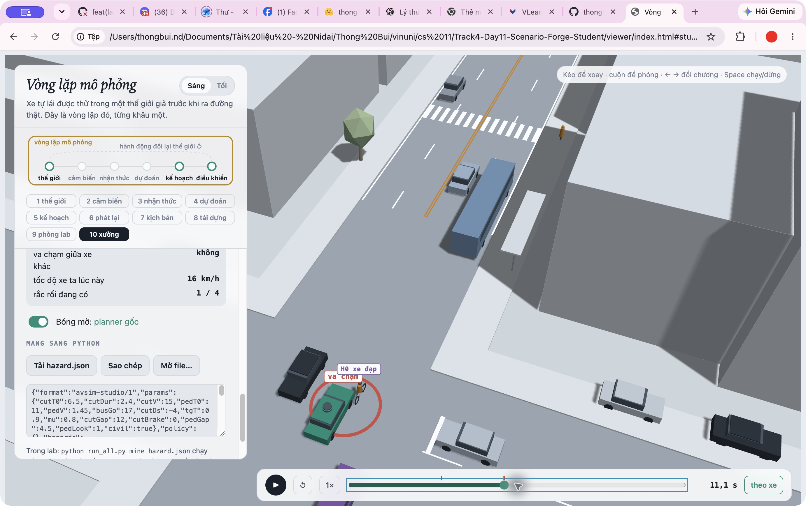

MSSV: 02931

# Lab 11 — Scenario Forge

Thị trấn: **B** (`meta.json: _run.town`). Mã lab `02931` giữ nguyên số 0 đầu; Bản lab kiểm tra dòng REPORT chỉ nhận 6–12 chữ số, nên chạy bằng cơ chế roster có sẵn: `LAB11_MSSV=02931 .venv/bin/python run_all.py all`, hoặc `./reproduce.sh`. Không sửa bộ mô phỏng, seed hay phân phối tự nhiên. Tất cả evidence dùng ngân sách đầy đủ (`_run.quick=false`).

## 1. Phát lại log có trung thực không?

`replay.json`: n=400, dropped_human_crash_logs=1, n_used=399; replay.crashes=127, replay.contact={'rear': 116, 'side': 11}; reactive.crashes=0, reactive.contact={}; crash_in_both=0.

Xe bám đuôi trong log chỉ phản ứng với người lái đã ghi, không biết planner phanh ở thời điểm khác. Vì vậy phần lớn tiếp xúc là rear: xe phía sau tiếp tục quỹ đạo cũ dù ego đã phanh. Đây là lỗi của phép phát lại, không phải bằng chứng planner gây tai nạn trong thế giới có phản ứng.

Ví dụ `replay_only[0]`: scenario=0, contact=rear; min_ttc_reactive=7.4606295 s. Cảnh này có hậu xe đâm ego khi phát lại; trong reactive không có thất bại. Ảnh: .

## 2. Kịch bản bất khả thi

`is_feasible` loại đổi làn nếu gia tốc ngang `(pi/cutDur)^2*3.5/2 > mu*g` (đòi lực bám vượt ma sát); loại phanh sau nhập làn `cutBrake > mu*g` (giới hạn lốp–đường); loại `pedV > 2.5 m/s` (vượt mô hình người đi bộ của bài); và loại `cutV` ngoài `(0,22] m/s` (miền tốc độ mô hình). Đây là giới hạn của thí nghiệm, không khẳng định mọi người thật đều đi dưới 2.5 m/s.

| Cuộc săn | infeasible | found |
| --- | ---: | --- |
| bus_bypass | 2 | {'bus_bypass': 172} |
| cut_in | 9 | {'crosswalk_block': 1, 'bus_bypass': 25} |
| crosswalk_block | 19 | {'crosswalk_block': 102} |
| rear_ended | 10 | {'bus_bypass': 11, 'crosswalk_block': 1} |

Trong cloud.json cả 40 mẫu bị loại vi phạm lực bám ngang khi đổi làn; đây là kiểm tra trực tiếp các params của mẫu out=infeasible. Cuộc săn loại nhiều nhất: **crosswalk_block**. CEM ưu tiên nguy hiểm, nên dễ dồn mẫu vào đổi làn nhanh, phanh mạnh hoặc kịch bản ma sát thấp; bộ lọc ngăn đếm các thất bại vật lý không thể xảy ra. Nếu tính chúng thành va chạm, ước lượng sẽ bị tăng giả. Các hàng trên trích `hunt.json: <mode>.infeasible/found`.

## 3. Monte Carlo

`mc.json`: crashes=4, n=3000, p=0.0013333333, Wilson 95%=[0.00051861726, 0.0034235347]; infeasible=10. Theo xấp xỉ sai số tương đối 20%, n ≈ 1.96²/(0.2²*p) ≈ **72,030** (quy tắc 96/p ≈ 72,000). Đây là tính cỡ mẫu theo p ước lượng, không phải bảo đảm khi p còn chưa biết.

| Kiểu | k | Wilson 95% |
| --- | ---: | --- |
| bus_bypass | 4 | [0.00051861726, 0.0034235347] |
| cut_in | 0 | [0, 0.0012788957] |
| crosswalk_block | 0 | [0, 0.0012788957] |
| rear_ended | 0 | [0, 0.0012788957] |
| other | 0 | [0, 0.0012788957] |

Các kiểu có k=0 chưa xuất hiện; cần báo cận trên Wilson trong bảng (`mc.json: per_mode.<mode>.hi`), không gọi xác suất thật bằng 0.

## 4. Importance sampling và suy biến

| seed | kiểu | p | hits | ess | top_share | upper_zero_hits |
| ---: | --- | ---: | ---: | ---: | ---: | ---: |
| 0 | bus_bypass | 0.0010142674 | 48 | 125.99438 | 0.183752 | — |
| 0 | cut_in | chưa thấy; xem cận | 0 | 117.6171 | 0 | 0.025 |
| 0 | crosswalk_block | 3.5646849e-06 | 139 | 101.06425 | 0.54553912 | — |
| 0 | rear_ended | chưa thấy; xem cận | 0 | 105.62456 | 0 | 0.025 |
| 1 | bus_bypass | 0.0017907932 | 44 | 109.57092 | 0.29889509 | — |
| 1 | cut_in | chưa thấy; xem cận | 0 | 146.9949 | 0 | 0.025 |
| 1 | crosswalk_block | 3.2081116e-06 | 150 | 115.33077 | 0.38419692 | — |
| 1 | rear_ended | chưa thấy; xem cận | 0 | 130.10518 | 0 | 0.025 |
| 2 | bus_bypass | 0.00054771949 | 40 | 145.13183 | 0.18663879 | — |
| 2 | cut_in | chưa thấy; xem cận | 0 | 131.79058 | 0 | 0.025 |
| 2 | crosswalk_block | 1.7011598e-06 | 130 | 95.047449 | 0.21595099 | — |
| 2 | rear_ended | chưa thấy; xem cận | 0 | 122.82728 | 0 | 0.025 |

Bảng trích `estimate.json: seeds[i].per.<mode>`. Cận khi chưa thấy = 3/(0.2*600)=0.025; ESS không phải số phép thử độc lập để dùng 3/ESS.

Các tổng theo seed (`total`, khoảng xấp xỉ có cận other): 0: 0.0010178321 [0.00037095978, 0.0029436001]; 1: 0.0017940013 [0.0004767315, 0.0043901668]; 2: 0.00054942065 [0.00022556936, 0.0021521676].

Những hàng top_share>0.5: seed 0/crosswalk_block (0.54553912). Khi top_share lớn, một mẫu đóng góp phần lớn tổng w*y; khoảng chuẩn dựa trên se có thể gây tự tin quá mức. ESS là độ đều của trọng số toàn bộ mẫu, không chứng nhận rằng đề xuất đã bao phủ mọi vùng thất bại.

Ngân sách IS (gồm săn) `estimate.json: budget`=16800; Monte Carlo cần khoảng 72,000 lần để đạt ±20% tại p hiện tại. Không được coi hai ngân sách này tự động có cùng độ chính xác: IS ở đây dùng đề xuất học được, có thể bỏ sót vùng và chênh seed.

Ba điểm ước lượng tổng IS đều nằm trong khoảng Wilson MC, nhưng max/min giữa seed là 3.265 lần, nên chưa đủ để tuyên bố ổn định. Với crosswalk_block ba seed cũng khác nhau, và cận của các kiểu chưa thấy vẫn lớn. CEM có thể dồn vào một đường va chạm rất hiếm, nên không ép IS khớp MC bằng cách đổi seed. Phần other lấy từ MC, không có mục tiêu nguy hiểm riêng để săn: {'k': 0, 'n': 3000, 'p': 0.0, 'hi': 0.0012788956648046956, 'source': 'mc.json'} (`estimate.json: other`). Khi k_other=0, tổng vẫn phải mang cận Wilson của other.

## 5. Các kiểu thất bại và 3D

Ảnh chọn từ cloud của chính lần chạy, không dùng lab-sample. bus_bypass tiếp xúc tại 12.70 s (ảnh 12.75 s), crosswalk_block bắt đầu tại 19.85 s (ảnh 19.90 s); dịch một khung 0.05 s để dấu sự kiện hiện rõ. Nguồn: evidence/shots/README.md.

`bus_bypass`: C2 tiến sát xe buýt đang dừng, lách vào hành lang ego trong lúc tốc độ C2 dưới 6 m/s và x<112 m; ego tiếp xúc với C2. Người lái C2 nhận khe theo mô hình, còn planner coi xe đó là leader quá muộn.

`crosswalk_block`: người P1 tới vạch sau xe buýt, xe buýt che tầm nhìn; ego phanh và dừng nhưng thân xe nằm trên đường đi của P1. P1 đứng lại thay vì đi vào xe; sự kiện block là thất bại chặn lối, không phải người tự đâm vào xe.

Kết quả từng cuộc săn theo `hunt.json: found` đã có ở câu 2. Không tìm được một kiểu không chứng minh kiểu đó không tồn tại; ngân sách hữu hạn, phụ thuộc scoring và đề xuất. Một cuộc săn chung dễ tập trung vào kiểu dễ tìm nhất và bỏ những kiểu khác; vì vậy dùng một đề xuất cho mỗi kiểu.

## 6. Sửa planner

Chọn trên TRAIN: policy={'cutinLat': 3.3} (`fix.json: chosen.policy`).

| Mẫu/policy | fail | fail_hi_seen | fail_hi | progress (m) | harsh (frames) |
| --- | ---: | ---: | ---: | ---: | ---: |
| baseline_train | 0.0011639193 | 0.0018376274 | 0.0018376274 | 216.28603 | 7.8046875 |
| chosen | 3.5544256e-06 | 6.0035909e-06 | 6.0035909e-06 | 215.65984 | 7.4179688 |
| baseline_test | 0.0011567609 | 0.0019292426 | 0.0032081383 | 214.21755 | 8.5136667 |
| chosen_test | 1.2286975e-06 | 1.9739523e-06 | 0.03878087 | 214.10822 | 7.8753333 |

Các số là trường cùng tên trong `fix.json`. harsh là số khung hình trung bình có a<-3 m/s², không phải số đợt phanh độc lập. Quãng đường chỉ tính đến thất bại. TRAIN sàng ứng viên; TEST dùng seed mới và săn lại cho chính policy; không chọn lại sau khi xem TEST.

fail_hi có thể lớn hơn fail của bản gốc dù điểm ước lượng thấp hơn: mỗi kiểu unseen trên TEST vẫn cộng 15/n=0.0375 với n=400, cùng cận other trên holdout tự nhiên; fail_hi_seen chỉ mang kiểu đã thấy và không đủ để chứng nhận an toàn.

Ảnh cùng cảnh bus_bypass ở 12.75 s: xe chính dùng cutinLat=3.3 và không va chạm; bóng mờ dùng policy gốc và va chạm tại 12.70 s. Tải evidence/shots/fix-viewer.json trong chương 9 để xem lại; tham số đầy đủ và sự kiện nằm trong evidence/shots/fix-scene.json. Núm thận trọng như giảm cautionV có thể khiến ego phanh sớm/mạnh, làm xe bám đuôi phản ứng; tăng khoảng nhường làm xe chuyển làn đổi thời điểm nhận khe. Do vậy phải đo toàn bộ thế giới phản ứng, không mặc định mọi núm an toàn đơn lẻ đều giảm thất bại. Bảng TRAIN dưới đây ghi kết quả thật của từng ứng viên, không diễn giải giả rằng một ứng viên đã gây tăng khi số không cho thấy điều đó:

| policy | fail TRAIN | fail_hi TRAIN | progress |
| --- | ---: | ---: | ---: |
| {'cautionV': 5.0} | 2.9057154e-05 | 7.0196189e-05 | 171.55934 |
| {'cautionV': 6.5} | 0.0011622097 | 0.0023285509 | 198.65923 |
| {'cautionV': 6.0} | 0.00053042852 | 0.0011830575 | 190.21274 |
| {'cautionV': 9.0} | 0.0024145606 | 0.0046739084 | 230.06965 |
| {'cautionV': 8.5} | 0.0026234963 | 0.0048478168 | 226.29909 |
| {'cutinLat': 2.6} | 0.00013775173 | 0.00029185134 | 215.94981 |
| {'cutinLat': 3.0} | 3.5547381e-06 | 6.0038992e-06 | 215.66909 |
| {'cutinLat': 3.3} | 3.5544256e-06 | 6.0035909e-06 | 215.65984 |
| {'T': 2.0} | 0.0011816779 | 0.0023586113 | 205.72544 |
| {'cutinLat': 3.0, 'cautionV': 6.5} | 2.2287429e-06 | 3.7388952e-06 | 198.38869 |
| {'cutinLat': 3.0, 'cautionV': 7.0} | 4.8604612e-06 | 7.6413888e-06 | 207.72981 |
| {'cutinLat': 2.6, 'cautionV': 7.0, 'pedBuffer': 3.5} | 2.8723262e-05 | 6.3250352e-05 | 208.16462 |

Một núm nghe an toàn hơn là tăng T từ 1.6 lên 2.0 s: TRAIN fail tăng từ 0.0011639193 lên 0.0011816779; riêng crosswalk_block tăng từ 3.5547815e-6 lên 1.2358981e-5 (fix.json: baseline_train và table[8]). Chênh tổng nhỏ và chưa chứng minh khác biệt thống kê. Cơ chế có thể xảy ra trong mô hình phản ứng là ego nhường nhiều hơn, làm thay đổi khe và thời điểm C2 nhập làn, thời điểm ego tới vạch và khe mà P1 nhìn thấy; tăng khoảng cách theo xe không bảo đảm tránh việc dừng thân xe trên vạch. Đây là diễn giải tương tác, không suy ra quan hệ nhân quả chắc chắn từ một điểm ước lượng.

## 7. Từ mô phỏng ra đường thật

Ba giả định cần thay: (1) cutGap log-normal với median=12 m ở town B: dùng video drone/camera giao lộ hoặc trajectory có khoảng cách trước–sau tại thời điểm nhập làn, phân tầng theo tốc độ; nếu khe thật nhỏ hơn mô hình, nguy cơ cut-in/bus-bypass có thể cao hơn báo cáo. (2) pedLook=0.85: gán nhãn video người đi bộ tại bến xe buýt (có nhìn vòng vật che trước khi bước không), dùng nhiều địa điểm/giờ; mô hình giả định nhìn nhiều hơn thực tế có thể đánh giá thấp chặn vạch. (3) wet=0.30, mu_wet=0.5: kết hợp nhật ký mưa, tình trạng mặt đường và đo giảm tốc/phanh theo lốp của đội xe; nếu tỷ lệ ướt cao hơn hoặc mu thấp hơn giả định, khoảng phanh lớn hơn và nguy cơ có thể bị đánh giá thấp. Đây là đề xuất thu dữ liệu, không tuyên bố đã thu hay đã fit.

## 8. Giới hạn

Thế giới chỉ một con phố/24 s, không đại diện mọi chuyến xe hoặc mọi nút giao; tác nhân dùng IDM và luật nhận khe, không có phản ứng đa dạng, mất tập trung hoặc tương tác thương lượng đầy đủ; cảm biến gần như hoàn hảo trừ che khuất hình học, không mô phỏng nhiễu/độ trễ nhận thức. Một tuần thêm: mở rộng tuyến và hành vi, hiệu chỉnh priors bằng video thật, lặp nhiều seed độc lập và tăng mẫu ở các kiểu unseen để giảm cận thay vì chỉ săn thêm ví dụ.

## 9. Rắc rối tự dựng

Xe đạp chạy 3 m/s từ làn ngoài tại x=50 m; khi ego còn cách 10 m, lạng trái 3.3 m trong 2.4 s. Tương ứng người đi xe đạp đổi làn bất ngờ; planner chỉ theo phản ứng khi đã vào hành lang nên có thể phanh muộn. Cảnh chính xác trong `mine.json: exact`={'planner': [['ego', 'H0', 11.05]]}.

`hazard.json: space`: {'h0_x': [45, 55], 'h0_trig': [8, 14], 'h0_swerve': [3.1, 3.5], 'h0_swDur': [2.4, 2.8]}. Căn cứ ở why: thiết kế thí nghiệm quanh x=50 ±5 m, trễ kích hoạt 8–14 m, dịch ngang gần một làn 3.1–3.5 m trong 2.4–2.8 s; gia tốc ngang cực đại 2.99858 m/s² dưới 3.0. Các khoảng là thiết kế sensitivity, không phân phối thực nghiệm. world=scene: giữ giao thông cảnh đã dựng. exposure=1 là đúng một hazard trong mỗi cảnh thí nghiệm, không ước lượng tỷ lệ mỗi chuyến ngoài đời.

`mine.json`: accepted=1, infeasible=0, conditional_on=your scene's traffic only.

| policy | n | crashes | avoidable | unavoidable | unattributed | low_speed | avoidable_foreknown | p (Wilson 95%) |
| --- | ---: | ---: | ---: | ---: | ---: | ---: | ---: | --- |
| baseline | 1500 | 988 | 988 | 0 | 0 | 0 | 988 | 0.65866667 [0.63429293, 0.68222976] |
| chosen | 1500 | 15 | 15 | 0 | 0 | 13 | 15 | 0.01 [0.0060693829, 0.016434051] |

Các trường trong bảng trích `mine.json: baseline/chosen`. avoidable dùng phanh tối đa từ khi hazard vừa hoạt động vừa nhìn thấy; avoidable_foreknown cho biết phanh ngay từ lúc bắt đầu dù bị che. unattributed không phải lỗi do hazard; low_speed là cờ nằm trong các loại, không cộng thêm vào tổng.

Không báo per-trip và không so trực tiếp với xác suất bus_bypass trong town: đây là P(lỗi | cảnh và dải hazard), trong khi bus_bypass là dưới traffic mix tự nhiên. Muốn quy ra mỗi chuyến cần đo exposure và phân phối vị trí/trigger thực tế, rồi chạy world=town.

Không ghi nhận người dùng tự lái, nên không khẳng định bạn đã tránh được. Oracle là chuẩn lạc quan vì biết ngay khi thấy và phanh tối đa, có thể đếm nhiều lỗi tránh được hơn planner thật; nhưng chỉ thử phanh, không đánh lái, nên có thể bỏ sót các va chạm tránh được bằng đánh lái. Đề xuất thêm dự đoán chuyển động ngang của xe đạp và phanh phòng ngừa trước khi thân xe đạp vào corridor, có xét lực bám và xe bám đuôi; đổi núm IDM một mình không thay được logic đó.

Kết luận riêng cho hazard: bản chọn giảm avoidable từ 988/1500 xuống 15/1500; 13 trong 15 tiếp xúc còn lại có ego dưới 1 m/s. Vì thế không diễn giải toàn bộ phần còn lại là ego chạy đâm xe đạp. cutinLat=3.3 đã giúp nhận xe đạp lấn ngang sớm hơn, nhưng vẫn còn lỗi tránh được, nên cần kiểm tra thêm logic dự đoán ngang thay vì tuyên bố đã giải quyết hoàn toàn.
